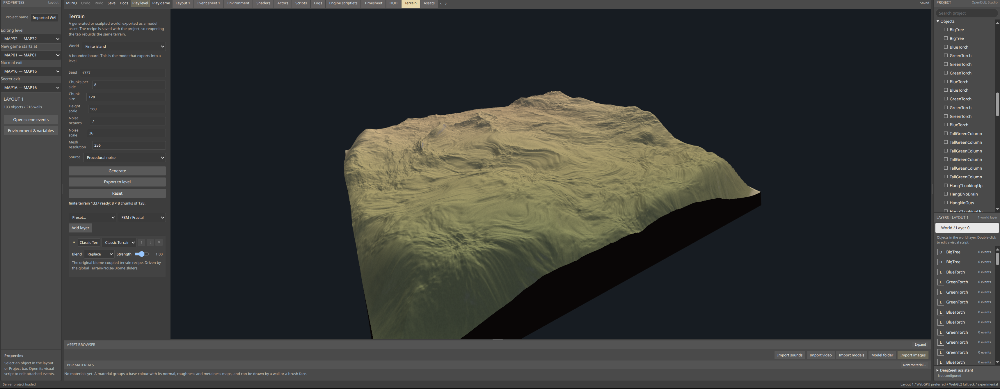

# Terrain

The **Terrain** tab generates a whole landscape — noise or hand-painted source, chunked meshes,
skirts, optional water — and exports it into the level as ordinary model geometry. It is powered by
[`procedural-terrains`](https://github.com/ZyFou/ProceduralTerrains) (MIT), a Three.js runtime
built from Terrain Studio 2.0.

## What is installed

| Piece | Version | Where |
| --- | --- | --- |
| `procedural-terrains` | 2.1.0 | `node_modules/procedural-terrains` → served at `/vendor/terrain/` |
| `three` (peer, `~0.185.1`) | 0.185.1 | `node_modules/three` → `/vendor/three/` |
| `fflate` (its only dependency) | 0.8.x | `/vendor/fflate/` |

The runtime is a viewer, not the studio: it ships `createTerrain`, `createTerrainViewer`, an
exporter (`GLB`/`OBJ`), document loading and the generation helpers. It does not ship the studio's
editor chrome, vegetation painting or the account/back-end pieces.

### How the modules reach the page

The studio has no bundler. `public/index.html` carries an import map that names **every** entry
point explicitly — `procedural-terrains/viewer`, `/export`, `/generation` and the rest. A prefix
mapping cannot be used: import maps do not add extensions, so `procedural-terrains/viewer` would
resolve to `/vendor/terrain/viewer` and 404. `test/terrain-tab.test.js` checks that each named
entry point is a real file.

The terrain tree also gets its own **specifier scope**, so its `three` is the classic
`three.module.js` build: the runtime constructs a `WebGLRenderer`, and the WebGPU build the rest of
the editor import-maps (`three.webgpu.js`) does not export one at all.

## World modes

The **World** selector is the runtime's four worlds, not a style choice:

| Mode | What it is | Exports to a level? |
| --- | --- | --- |
| **Finite island** | a bounded board, the one the exporter meshes | **yes** |
| **Infinite** | streams chunks around the camera, no boundary | no — preview |
| **Planet** | a cube-sphere planet (needs a noise stack to evaluate in 3D) | no — preview |
| **Mini diorama** | a small preset (cove, mesa, atoll, ridge, isles) with its own relief | no — preview |

The tab runs its own viewport (`public/terrain-viewport.js`: renderer, scene, orbit camera, frame
loop) rather than the package's single-world viewer, because it needs all four modes *and* a click
that lands on the terrain. `Export to level` is disabled with the reason on the button outside the
finite board — a mode that cannot be exported should not offer a button that does nothing.

## Sculpting

**Source → Sculpted shapes** switches the recipe from a pure noise stack to the runtime's *manual*
document: a list of parametric stamps over the stack (or over flat ground, with **Sculpt over**).

- **Add shape** puts a stamp in the list: mountain, ridge, wide valley, canyon, plateau or crater,
  each starting at its catalogue size, height and detail.
- Select a shape to edit it: position, width and depth, height, rotation, sharpness, detail,
  terraces, opacity, blend (`add`/`subtract`/`max`/`min`/`replace`/`average`) and a mask
  (none/radial/box/noise, with invert and feather).
- **Click the terrain to place it.** The click raycasts the world and writes the shape's `x`/`z`,
  which is the whole interaction of stamping. A drag orbits the camera instead — a press that moved
  more than a few pixels is not a placement.
- Every edit rebuilds the world, debounced, so the shapes are edited against what they look like.

Stamps are a document, not a mesh: `project.terrain.shapes` holds them, so a sculpted world reopens
for the next author and the export can be repeated at another resolution.

## Freehand sculpting and painting

Below the shape list, **Brush** arms a stroke over the terrain. With it off, dragging orbits the
camera; with it on, the drag belongs to the brush, which is why the two never fight over the pointer.

**Sculpt height** writes the runtime's `sculpt` document — a height-delta grid, one float per cell:

```json
{ "version": 1, "resolution": 256, "data": "<base64 of resolution² float32>" }
```

Raise and lower add or subtract `strength` with a smooth radial falloff; **smooth** pulls each cell
toward its neighbours so a ridge softens without the landmass moving. The status line reports how
many cells were touched and the height range, which is the only honest way to see a stroke that has
landed. Resolution (128/256/512) is fixed per project; a stored sculpt at another resolution is
resampled into the grid rather than dropped.

**Paint surface** writes the runtime's `surfacePaint` document, exactly in its own format: a
1024 × 1024 grid split into 4 × 4 tiles of 256 × 256, four layer weights packed into the fourth
channel of each tile group, tiles base64-of-zlib:

```json
{ "version": 2, "origin": {"x": -512, "z": -512}, "span": {"x": 1024, "z": 1024}, "resolution": 1024,
  "layers": [{ "id": "paint_1", "materialInstanceId": "grass", "name": "Grass", "slot": 0,
               "visible": true, "locked": false, "opacity": 1 }],
  "tiles": [{ "key": "1,1,0", "data": "<base64 of zlib(256·256·4 bytes)>" }] }
```

Add a layer per surface material (grass, rock, sand, mud, alien — the packs that ship with the tab),
then paint, erase, blend or erase-all. Only touched tiles are stored, so painting a corner of a
board stays small; a layer's checkbox and opacity feed the runtime's own per-slot uniforms.

Both documents are written into the project on every stroke and pushed into the **live** world with
`configure`, which rebuilds the height field without recreating the renderer, scene or camera — a
stroke refines the terrain under the pointer instead of reloading the tab. During a stroke that
happens at most every ~320 ms; on release it happens at once.

## The layer editor

The recipe's shape is a **noise stack**: an ordered list of layers, each one blended into what the
layers above it produced (`replace` starts again from flat). The panel is the studio's
`NoiseLayersPanel` rebuilt in this editor's own DOM — no React, and no copy of its engine:

- **Preset** applies one of the studio's six recipes (Classic, Rolling Hills, Sharp Mountains, Canyon
  Terraces, Desert Dunes, Moon Craters) as a starting point; every layer stays editable afterwards.
- **Add layer** appends a layer of the chosen type. The type list, each type's description and every
  parameter field (label, range, step, default) come from the runtime's own `NOISE_TYPES` schema, so
  a type the package adds appears without touching this repository.
- Each card has enable, name, type, up/down and remove, plus blend mode and strength. Changing the
  type replaces the layer's parameters with the new type's defaults and keeps its place and name.
- Any edit regenerates the world after a short pause, so the panel is an editor rather than a form.

With a stack present, the **Noise octaves** and **Noise scale** fields stand down (they are the
classic single-layer recipe and the stack ignores them); they come back with **Reset**.

The stack is stored in `project.terrain.stack` and validated with the project, so a world authored
here reopens for the next person exactly as it was.

## Surface packs

The five classic packs — grass, rock, sand, mud, alien — are copied from the studio into
`public/textures/terrain/`, together with a `materials.json` trimmed to those five (about 430 KB;
the studio's full PBR library is 1.1 GB and is deliberately *not* vendored). The runtime reads the
manifest at `/textures/terrain/materials.json`, so adding a pack later means copying its folder and
adding its manifest row.



## Using the tab

1. Open **Terrain** in the tab strip. The viewer starts on the recipe the project stores, or on the
   defaults (`seed 1337`, 8 × 8 chunks of 128, height 560) when it has none.
2. Set the recipe: seed, chunks, chunk size, height scale, noise octaves, noise scale and mesh
   resolution. **Generate** rebuilds the world; **Reset** restores the defaults.
3. **Export to level** meshes it and places the result.

The recipe is saved **with the project** (`project.terrain`), not in the browser: reopening the tab
rebuilds the same world, and another author opening the project sees the same one. The mesh is
never stored twice — the export becomes an ordinary model asset, exactly like a GLB dragged into
the Assets browser.

### What the export produces

`exportTerrain` returns a map of file name to bytes (mesh, heightmap, collision, splat, preset).
The tab takes the mesh — `*.glb` preferred, `*.obj` accepted — and runs it through the project's own
model import (`bundleModel`), so the terrain lands as:

- one **asset** of kind `model`, with the usual metadata and a generated thumbnail;
- one **object** of type `decoration` carrying that model, placed at the player's position, with a
  `fixed` body whose collider is the mesh's own triangles (`shape: model`, `modelCollision: trimesh`).

The object is an ordinary object: move it, scale it, swap the collider, attach a visual script.

### Walking on it

A decoration carrying a picture is scenery, and a terrain that is scenery is a hole in the floor: the
player walked through it and every monster stood on the sector floor *under* the hill. Two things make
it ground:

- **The body.** The exported object is solid, and its own triangles are the collider, so the player's
  capsule stands on the slope it can see.
- **The surface.** `createTerrainSurface()` (`shared/terrain-surface.js`) indexes those same
  triangles into a 16-unit grid once per level, and `floorAt()` answers with the higher of the sector
  floor and the model surface. That single change is what puts monsters, pickups, bullets, rockets and
  line-of-sight on the terrain: a walker climbs a slope, refuses a cliff, shoots what it can see and
  cannot see through a hill.

`state.terrainSurface` is null for a level with no solid model, and every query then costs one
property read, so nothing gets slower for the campaigns that have no terrain.

What it does **not** do: the surface is sampled every eight units along a trace, so a razor-thin
ridge can be stepped over by a shot; and a model whose collision is the convex hull of its shape
(`modelCollision: convex`) contributes no surface, because a hull's triangles are not the ground you
can see.

### Ranges the runtime enforces

The runtime validates its own configuration and refuses values by name rather than clamping them.
The tab and `validateProject` use the same ranges, so a project cannot store a recipe its viewer
will not open:

| Setting | Range |
| --- | --- |
| `seed` | −2 147 483 648 … 2 147 483 647 |
| `chunkCount` | 1 … 64 |
| `chunkSize` | 8 … 4096 |
| `heightScale` | 0 … 100 000 |
| `octaves` | 1 … 16 |
| `scale` (noise) | 0.01 … 1000 |
| `seaLevel` | −100 000 … 100 000 |

## Notes and limits

- The viewer needs **WebGL2**. Without it the tab says so instead of showing an empty box; the rest
  of the editor is unaffected.
- The runtime's shaders use their own sun and ambient terms, so the terrain is lit differently from
  the level's sectors. The exported mesh keeps vertex colours and baked lighting options you choose
  in `exportTerrain`.
- Terrain geometry is a mesh, not brushes. A mirrored, gameplay-critical room is still built from
  brushes; a landscape backdrop, a skybox island or a distant range is what this is for.
- An export is capped by the model import path at 16 MiB per asset. Lower **Mesh resolution** if
  the export exceeds it.
- `project.terrain` stores the recipe only. Deleting the object does not delete the recipe, and
  deleting the recipe does not remove an exported asset.

## Regenerating or upgrading

```sh
npm install procedural-terrains@latest three@~0.185.1
```

Then check the import map in `public/index.html` still names every entry point in the package's
`exports` (the test will tell you if a new one appeared), and run `npm test`.
