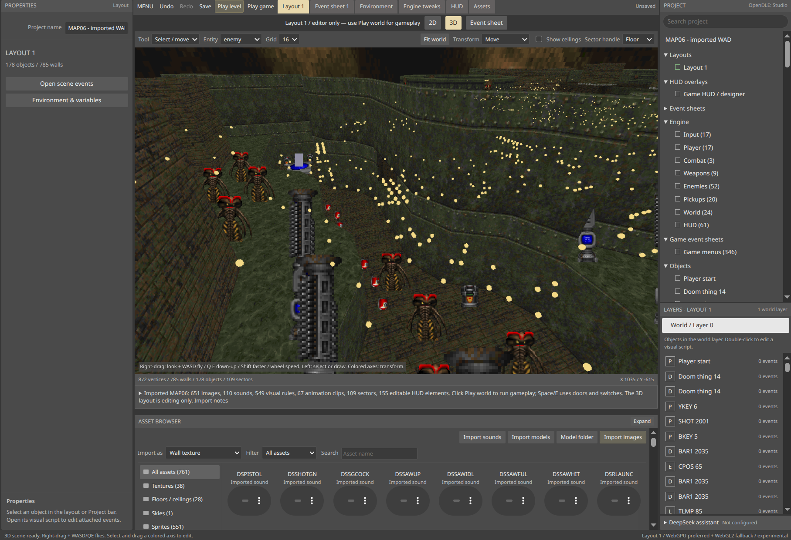
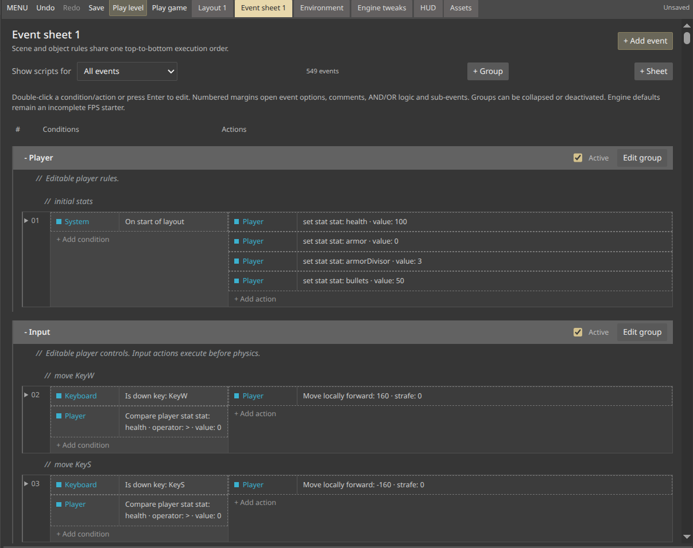
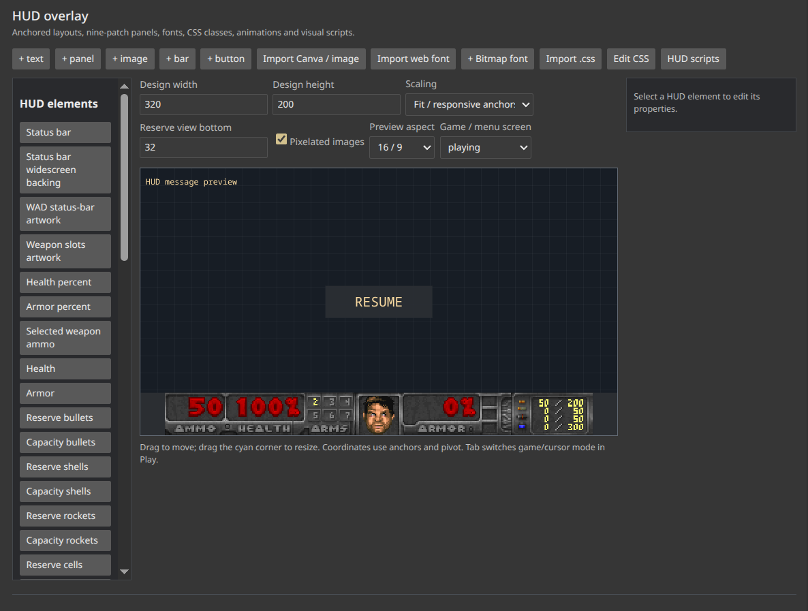
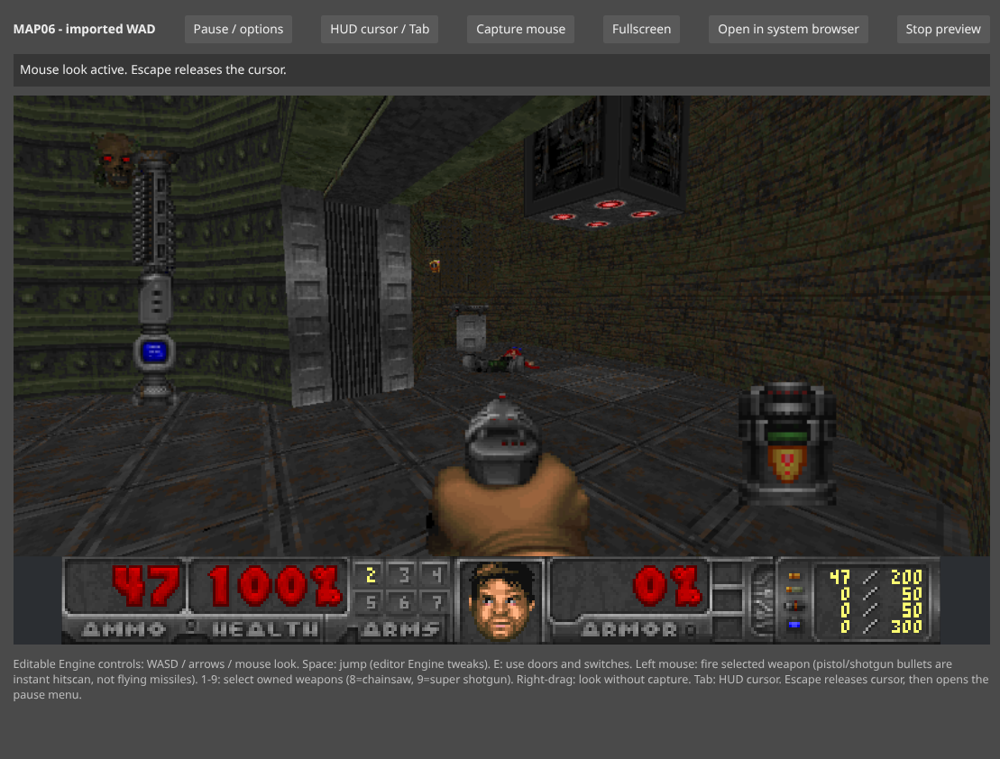

# OpenDLE: Studio

**Build worlds. Script visually. Make them playable in your browser.**

OpenDLE: Studio is an experimental, source-available **Doom/GZDoom-compatible game
engine** that runs in the browser, with a **no-code visual editor**: import WAD and PK3
levels, edit sectors and objects in 2D and 3D, script gameplay with Construct-inspired
event sheets and GDevelop-style conditions/actions, and press play without leaving the
page.



## See it in action

| Visual event scripting | HUD and menu design |
| --- | --- |
|  |  |



## Create without starting from code

- **Visual world editing:** build and edit sectors, rooms, materials, lighting
  and objects in 2D and 3D.
- **Editable gameplay:** attach visual events to objects, use local variables,
  expressions and named signals, and customize imported gameplay. Game-wide and object-local
  scripts are separate authoring scopes; see
  [visual scripting](Docs/visual-scripting.md).
- **Reusable scene nodes:** manipulate models, sprite planes, meshes, sound and
  video surfaces; save groups as portable `.node` files. Build mouse-operated
  terminals directly on 3D surfaces and connect them to configurable sector doors.
  Start with the [node editor and terminal guide](Docs/node-editor.md).
- **Choose the movement:** Doom's thrust-and-friction, or Half-Life / Source
  movement with its air-strafing and surf. The scriptlet installs the rule, and can
  build a new empty map with two surf ramps to try it on; every constant is editable.
- **Bring your worlds along:** import WAD, PK3 and standalone IPK3 resources,
  classic Doom and UDMF game levels, textures, sprites, weapons, sounds,
  MIDI/MUS level music and supported game menus.
  Keep supported original episode menus and editable level-finish screens;
  switch levels in the editor or during play.
- **Design the interface:** edit HUDs and menus with responsive layouts,
  animations and gameplay bindings, including native browser save/load slots.
- **Save what you want, when you want:** rules can write the project variables or
  the whole game to a `.json` save file and load it back — a custom checkpoint
  system with no menu in the way — and **Save files** in the play toolbar
  downloads or imports those documents, so a save outlives the browser.
- **Play with a controller:** PS5, PS4, Xbox and Switch Pro pads work with no setup —
  sticks, triggers, d-pad and menus — and a rule can rumble them.
- **Browser-native rendering:** WebGPU preferred, WebGL2 fallback, Rapier
  physics, portable GLSL effects and a [shader engine](Docs/shader-engine.md)
  ported from *3D Game Shaders For Beginners* with events to drive it at play time.
- **AI-ready tools:** MCP integration and optional DeepSeek-assisted edits,
  with drafts reviewed before applying.
- **Extend your workflow:** install project addons or add drop-in scriptlet
  generators, and edit any texture, flat, sprite or sky in
  [PixiEditor](Docs/pixieditor.md). See [extensions](Docs/extensions.md) and
  [scriptlets](Docs/scriptlets.md).

## Try it locally

Requires **Node.js 22.12+** and **npm**. The Electron desktop runtime is installed
as a project dependency (its binary downloads on first desktop launch).

```sh
git clone https://github.com/Finalizator/OpenDLE-Studio.git
cd OpenDLE-Studio
npm ci
npm start
```

Studio opens in its **own window**, without browser tabs or an address bar.
It uses a dedicated **Electron desktop shell**, with a separate persistent app profile
instead of your personal browser session. No Chrome/Brave installation is needed.
On Linux/macOS, `./launch.sh` also
handles dependency setup and opens the same Studio window.

On Windows, double-click [launch.bat](./launch.bat) in the downloaded/cloned
engine folder. It installs Node.js LTS through Windows Package Manager (`winget`)
if Node.js 22.12+ or npm is missing, runs `npm ci` if project dependencies are
missing, and opens Studio. Node installation may request administrator approval.
If `winget` is unavailable, install Node.js LTS with npm from
[nodejs.org](https://nodejs.org/) first. Keep the launcher terminal open;
Ctrl+C stops its server. Stop an existing server before launching again on Windows.
Command-line options also work: `launch.bat --browser` or `launch.bat --no-browser`.

Use `npm start -- --browser` for a normal browser tab, or
`npm start -- --no-browser` for the local service only. `npm run serve` starts
only the server without automatically restarting an existing instance.
The editor remains available at **http://127.0.0.1:3000/**.
Project edits autosave to the local project folder after a short idle period,
including large campaigns. Closing the Studio window waits for pending saves;
save failures keep it open with an error. **Save** is still available at any time.
Save any unsaved browser drafts before switching to the Studio window; its
profile does not inherit your browser's local storage or license acceptance.
The launcher prints errors rather than silently falling back to a browser tab
if the desktop runtime cannot start.
Use **Play level** to test the current map or **Play game** to open its menus.
DeepSeek is optional; configure it using [.env.example](./.env.example).

## Documentation

- [Node editor, terminals and doors](Docs/node-editor.md): viewport controls,
  reusable node import/export, local variables, signals and a step-by-step code lock.
- [Visual scripting reference](Docs/visual-scripting.md): event scopes, phases,
  conditions/actions and command parameters.
- [Extensions (addons)](Docs/extensions.md): installation, a complete example,
  manifest and JavaScript API, local development and packaging.
- [Adding and writing scriptlets](Docs/scriptlets.md): folder discovery,
  generator lifecycle, authoring helpers, testing and troubleshooting.
- [Editing textures in PixiEditor](Docs/pixieditor.md): opening artwork from the
  asset browser and inspectors, finding the editor, and the export/reload round trip.
- [Shader engine](Docs/shader-engine.md): the pass stack, every technique and its
  parameters, presets, and the events that control it while the game runs.
- [GZDoom compatibility](Docs/gzdoom-parity.md): implementation status and gaps.
- [Development Guide](DEVELOPMENT.md): setup, persistence, architecture, MCP and
  contributor workflows.

The ready-made [Access terminal node](public/examples/access-terminal.node) uses
PIN **1234**, per-instance `digits` and a `submitted` signal. Its door connection
is authored in the destination layout; see the
[setup walkthrough](Docs/node-editor.md#connect-the-terminal-to-one-specific-door).

## Where we're heading

Our goal is full, one-way GZDoom game import into native, editable OpenDLE
projects—with room to build beyond the original engine.

Playtest failures are written to `logs/playtest/` as they happen, one file per
session, and can be read from the Logs tab or by the assistant over MCP.

To play the real Doom 2 in GZDoom for comparison, `npm run gzdoom:fetch` installs a
pinned GZDoom and `./GZDoom.sh` runs it as a normal game, with your own config and
with any arguments passed through. It prints the controls on start, and fills in
the keys GZDoom leaves unbound (its default layout has no arrow keys at all) the
first time it runs.

**This is an early engine, not complete GZDoom compatibility.** Imported weapons,
enemies and pickups run their own DECORATE/ZScript state machines, map line
specials execute natively, and each map's compiled ACS module (`BEHAVIOR`) runs
at Doom's 35 Hz inside the engine, together with the game's `LOADACS` script
libraries. Actor translations, morphs and ANIMDEFS camera textures
(`SetCameraToTexture`) are performed rather than reported. Action functions the
runtime cannot execute are skipped at the frame
that calls them and reported instead of failing silently: in the import notes, as
a note in the Actors tab, in playtest logs and through the `actor_unsupported` MCP
tool. Arbitrary ZScript code, portals, slopes and 3D floors remain
unsupported. Custom
SBARINFO HUDs and MENUDEF menus have editable, partial translation—not yet full
GZDoom interface compatibility. No commercial game data is included; supply
content you have permission to use.

## Source available. Contributions welcome.

You can inspect the source, make private modifications and propose contributions.
Independent redistributed engine forks are restricted. Contributions require
explicit permission for use and relicensing before they are merged.


For setup details, architecture, compatibility notes and contributor workflows,
see the [Development Guide](./DEVELOPMENT.md).
