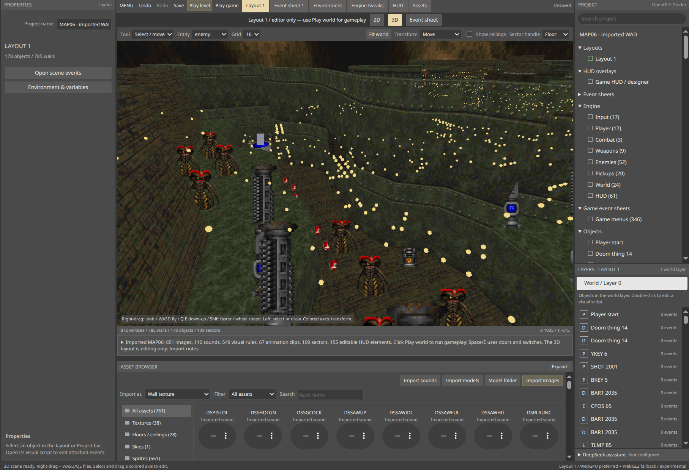
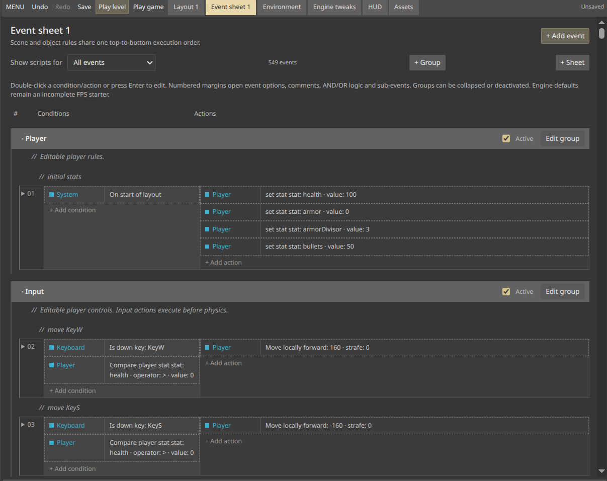
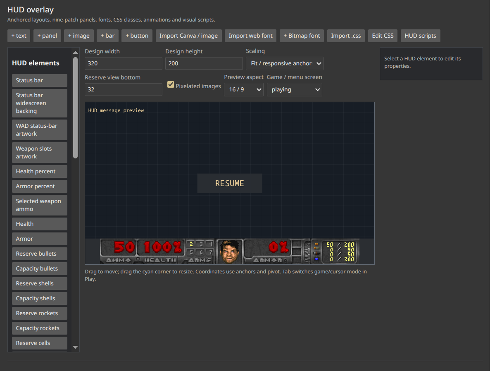
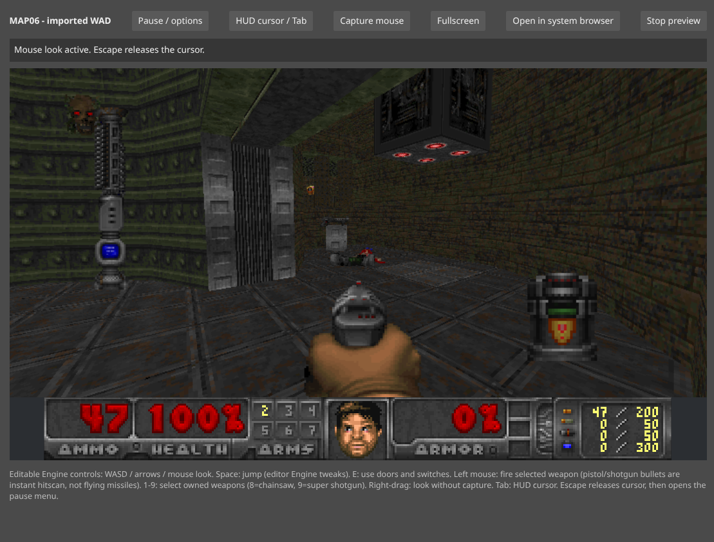

# OpenDLE: Studio

**Build worlds. Script visually. Make them playable in your browser.**

OpenDLE: Studio is an experimental, source-available game engine and visual
editor combining Doom-style worlds, a Construct-inspired workspace and
GDevelop-style condition/action scripting.



## See it in action

| Visual event scripting | HUD and menu design |
| --- | --- |
|  |  |



## Create without starting from code

- **Visual world editing:** build and edit sectors, rooms, materials, lighting
  and objects in 2D and 3D.
- **Editable gameplay:** attach visual events to objects, use local variables
  and expressions, and customize imported gameplay. Game-wide and object-local
  scripts are separate authoring scopes; see
  [visual scripting](Docs/visual-scripting.md).
- **Bring your worlds along:** import WAD, PK3 and standalone IPK3 resources,
  classic Doom and UDMF game levels, textures, sprites, weapons, sounds,
  MIDI/MUS level music and supported game menus.
  Keep supported original episode menus and editable level-finish screens;
  switch levels in the editor or during play.
- **Design the interface:** edit HUDs and menus with responsive layouts,
  animations and gameplay bindings, including native browser save/load slots.
- **Browser-native rendering:** WebGPU preferred, WebGL2 fallback, Rapier
  physics and portable GLSL effects.
- **AI-ready tools:** MCP integration and optional DeepSeek-assisted edits,
  with drafts reviewed before applying.

## Try it locally

Requires **Node.js 22+** and **npm**.

```sh
git clone https://github.com/Finalizator/OpenDLE-Studio.git
cd OpenDLE-Studio
npm ci
npm start
```

Open **http://127.0.0.1:3000/** 
On Linux/macOS, `./launch.sh` also handles dependency setup and browser launch.
Use **Play level** to test the current map or **Play game** to open its menus.
DeepSeek is optional; configure it using [.env.example](./.env.example).

## Where we're heading

Our goal is full, one-way GZDoom game import into native, editable OpenDLE
projects—with room to build beyond the original engine.

Playtest failures are written to `logs/playtest/` as they happen, one file per
session, and can be read from the Logs tab or by the assistant over MCP.

To play the real Doom 2 in GZDoom for comparison, `npm run gzdoom:fetch` installs a
pinned GZDoom and `./GZDoom.sh` runs it as a normal game, with your own config and
with any arguments passed through.

**This is an early engine, not complete GZDoom compatibility.** Imported weapons,
enemies and pickups run their own DECORATE/ZScript state machines, map line
specials execute natively, and each map's compiled ACS module (`BEHAVIOR`) runs
at Doom's 35 Hz inside the engine, together with the game's `LOADACS` script
libraries. Actor translations, morphs and ANIMDEFS camera textures
(`SetCameraToTexture`) are performed rather than reported. Action functions the
runtime cannot execute are skipped at the frame
that calls them and reported instead of failing silently: in the import notes, as
a note in the Actors tab, in playtest logs and through the `actor_unsupported` MCP
tool. Arbitrary ZScript code, portals, slopes and 3D floors remain
unsupported. Custom
SBARINFO HUDs and MENUDEF menus have editable, partial translation—not yet full
GZDoom interface compatibility. No commercial game data is included; supply
content you have permission to use.

## Source available. Contributions welcome.

You can inspect the source, make private modifications and propose contributions.
Independent redistributed engine forks are restricted. Contributions require
explicit permission for use and relicensing before they are merged.


For setup details, architecture, compatibility notes and contributor workflows,
see the [Development Guide](./DEVELOPMENT.md).
